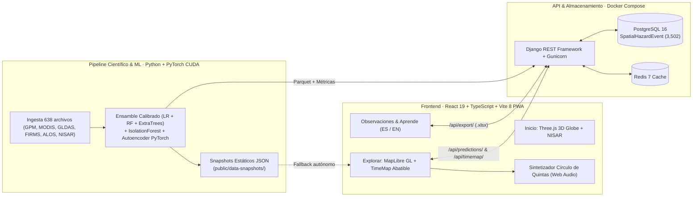

<div align="center">



<p>
  
  
  
  
  
  
  
</p>

**Atlas interactivo de observación terrestre, minería de datos multisensor y sonificación armónica para México.**<br />
Cobertura de las **32 entidades federativas**, **2,478 municipios** y **216 meses (`2010-01` – `2027-12`)** con **3,502 registros georreferenciados** y **32 predicciones estatales mensuales para todo 2027**.

[Inicio Rápido](#-inicio-rápido) · [Arquitectura](#️-arquitectura-del-sistema) · [Benchmarks](BENCHMARKS.md) · [Despliegue 3 Meses](docs/deployment-3-meses.md) · [Créditos](#-créditos-y-equipo)

</div>

---

## ✨ Características Principales

- **Globo 3D interactivo (`/`)**: Escena **Three.js** optimizada con textura *NASA Blue Marble*, campo de estrellas por *shaders*, órbita ilustrativa NISAR, control táctil/teclado y liberación automática de contexto WebGL al cambiar de pestaña.
- **Mapa explorador y TimeMap abatible (`/explorar`)**: Cartografía vectorial **MapLibre GL JS** sobre los 32 estados y 2,478 municipios del **INEGI**, línea del tiempo colapsable (`2010-01` – `2027-12`) mediante clics/taps, filtros por entidad federativa y amenaza, exportación `.xlsx` filtrada y mini-tutorial accesible de 4 pasos.
- **Sonificación por Círculo de Quintas (`Web Audio API`)**: Convierte la severidad e historial de fenómenos (**sismo, ciclón/inundación, incendio y sequía**) en acordes e intervalos armónicos sobre quintas musicales mientras recorres el TimeMap.
- **Observaciones y Predicciones 2027 (`/observar`)**: Consulta libre por **Año**, **Mes**, **Estado** y **Amenaza** sobre registros históricos (`observed`), modelos calibrados (`supervised`), indicadores físicos (`proxy`) y proyecciones completas para los **12 meses de 2027** (`32` predicciones estatales por mes).
- **Aprende (`/learn`)**: Explicaciones claras y visuales sin sobrecarga técnica, procedencia verificada de los sensores, actividad interactiva y selector bilingüe **ES / EN**.
- **Modo dual Online + Offline (`PWA`)**: Conecta en vivo contra **Django REST + PostgreSQL 16 + Redis 7** y respalda automáticamente con *snapshots* estáticos (`public/data-snapshots/`) para funcionar incluso de forma autónoma en GitHub Pages.

---


## 🏗️ Arquitectura del Sistema



---

## 📊 Resumen de Benchmarks y Validación

El reporte completo con tiempos secuenciales vs. paralelos, métricas por modelo y latencias de base de datos está documentado en **[BENCHMARKS.md](BENCHMARKS.md)**.

| Dimensión Evaluada | Resultado Medido | Referencia |
| :--- | :--- | :--- |
| **Volumen ingestivo** | `638` archivos satelitales/radar (`0` advertencias de inventario) | [BENCHMARKS.md](BENCHMARKS.md) |
| **Catálogo PostgreSQL 16** | `3,502` eventos · `216` meses · `32` estados · `384` predicciones `2027` | [BENCHMARKS.md](BENCHMARKS.md) |
| **Limpieza SAR (ALOS NPZ)** | `0.6637 s` en `14` workers (`1.61×` vs. secuencial) | [BENCHMARKS.md](BENCHMARKS.md) |
| **Cubos NASA GPM IMERG** | `0.0127 s` con **Dask** (`51.1×` vs. `h5py-streaming`) | [BENCHMARKS.md](BENCHMARKS.md) |
| **Autoencoder PyTorch** | `14.247 s` en **GPU CUDA AMP** (`1.66×` vs. CPU) | [BENCHMARKS.md](BENCHMARKS.md) |
| **Backtesting Inundaciones (80/20)** | **ROC-AUC `0.9944`** · **F1 `0.9756`** · **Brier `0.0518`** | [BENCHMARKS.md](BENCHMARKS.md) |
| **Backtesting Incendios (80/20)** | **ROC-AUC `0.8571`** · **Precisión `1.0000`** · **Brier `0.2343`** | [BENCHMARKS.md](BENCHMARKS.md) |
| **Latencia HTTP API (`PostgreSQL`)** | `23.12 ms` (`/api/predictions/?period=2027-08`) · `287.51 ms` (`/api/timemap/`) | [BENCHMARKS.md](BENCHMARKS.md) |

---

## 🗂️ Estructura del Repositorio

```text
404-Gravity-Not-Found/
├── .github/workflows/       # CI/CD automático hacia GitHub Pages
├── config/                  # Perfilado dinámico de hardware (CPU/RAM/GPU)
├── data/
│   ├── interim/             # Características estatales mensuales y etiquetas externas
│   └── processed/           # Catálogos Parquet, modelos entrenados y métricas JSON
├── deployment/              # Dockerfiles (API/Frontend), Nginx y guía de producción
├── docs/
│   ├── assets/              # Banners y separadores SVG animados del repositorio
│   ├── entrega/             # Documento técnico y presentación en LaTeX / PDF
│   ├── arquitectura.md      # Decisiones de arquitectura e integración
│   └── deployment-3-meses.md# Guía gratuita / estudiante para despliegue por 3 meses
├── nasa_api/                # Backend Django REST Framework, modelos PostgreSQL y Excel
├── pipeline/                # Limpieza SAR, cubos NASA, ensamble ML y backtesting 80/20
├── public/
│   ├── assets/              # Textura Blue Marble y logotipo oficial del equipo
│   ├── data-snapshots/      # Snapshots JSON para modo autónomo en GitHub Pages
│   ├── fonts/               # IBM Plex Sans local (licencia OFL)
│   └── geojson/             # Cartografía INEGI (32 entidades y 2,478 municipios)
├── scripts/                 # Exportación de snapshots, verificación de stack y geografía
├── src/
│   ├── componentes/         # Layout, navegación, barra de idioma y mini-tutorial
│   ├── configuracion/       # Identidad centralizada del proyecto y rutas
│   ├── estilos/             # Paleta de 28 colores y tema responsive
│   ├── funcionalidades/     # Módulos: inicio, explorar, observaciones y aprendamos
│   └── utils/               # Motor Web Audio API (Círculo de Quintas)
├── tests/                   # Suite pytest del pipeline científico y backtesting
├── BENCHMARKS.md            # Reporte detallado de rendimiento y minería de datos
├── compose.deploy.yaml      # Orquestación de producción (Nginx + API + Postgres + Redis)
├── docker-compose.yml       # Orquestación de desarrollo local
└── vite.config.ts           # Configuración Vite 8, proxy API y Workbox PWA
```

---

## 🚀 Inicio Rápido

### 1. Stack completo en local (`PostgreSQL 16 + Redis + Django + Vite`)

Requiere **Docker Desktop**, **Node.js 20.19+ / 22.12+** y **pnpm**:

```sh
pnpm install --frozen-lockfile
pnpm stack:up
pnpm dev --host 127.0.0.1 --port 5173 --strictPort
```

- Aplicación web: `http://127.0.0.1:5173/`
- Estado del catálogo: `http://127.0.0.1:8000/api/catalog/status/`
- Predicciones 2027: `http://127.0.0.1:8000/api/predictions/?period=2027-08`
- Documentación Swagger: `http://127.0.0.1:8000/api/docs/swagger/`

### 2. Verificación y pruebas

```sh
pnpm lint                                    # Oxlint sobre 58 archivos TS/TSX
pnpm typecheck                               # TypeScript estricto
pnpm build                                   # Compilación Vite + PWA Workbox
pnpm datos:verificar                         # Integridad SHA-256 de GeoJSON INEGI
python -m unittest nasa_api.test_catalog -v  # Pruebas unitarias Django/Excel/API
python -m pytest tests/ -v                   # Pruebas del pipeline científico y ML
```

### 3. Despliegue (3 meses sin costo)

Consulta **[docs/deployment-3-meses.md](docs/deployment-3-meses.md)** y **[deployment/README.md](deployment/README.md)** para publicar en **GitHub Pages + DigitalOcean Student Pack / Render + Neon**.

---


## 👥 Créditos y Equipo

<div align="center">
  
  <h3>Equipo 404 Gravity Not Found</h3>
</div>

Integrantes del proyecto (en orden alfabético):

1. **Arturo Huerta Maldonado**
2. **Gael Askary Razo Montañez**
3. **Isaac Aguilar Durán**
4. **Juan Enrique Gutiérrez Hernández**
5. **Karla Yaneth Cruz Sandoval**
6. **Limhi Gerson López Momox**

### 🛰️ Fuentes de Datos y Créditos Científicos

| Fuente / Recurso | Cobertura y Uso en TerraSync |
| :--- | :--- |
| **NASA GPM IMERG v07B** | Precipitación satelital mensual (`0.1°`) para modelado hidrológico. |
| **NASA Terra MODIS MOD11C3** | Temperatura superficial terrestre LST día/noche (`0.05°`). |
| **NASA GLDAS Noah v2.1** | Humedad del suelo, escurrimiento superficial y balance hídrico (`0.25°`). |
| **NASA FIRMS (VIIRS) & NASA EONET v3** | Focos activos de calor, eventos naturales e incendios forestales. |
| **JAXA ALOS PALSAR & NASA-ISRO NISAR (GCOV)** | Retrodispersión polarimétrica radar SAR para anomalías y análisis tectónico. |
| **NOAA IBTrACS v04r01** | Verdad terreno histórica de ciclones (Atlántico Norte + Pacífico Oriental). |
| **USGS Earthquake Catalog** | Sismicidad histórica confirmada (`M ≥ 4.0`). |
| **INEGI Marco Geoestadístico (dic. 2025)** | Límites oficiales de 32 entidades federativas y 2,478 municipios de México. |
| **terrestris / mundialis TOPO-WMS (SRTM/NASA)** | Relieve topográfico sombreado 2D de fondo en el mapa interactivo. |
| **NASA Blue Marble (jul. 2004)** | Textura terrestre utilizada en el globo 3D de la portada. |
| **IBM Plex Sans (`OFL.txt`)** | Tipografía servida localmente para consistencia visual y accesibilidad. |
